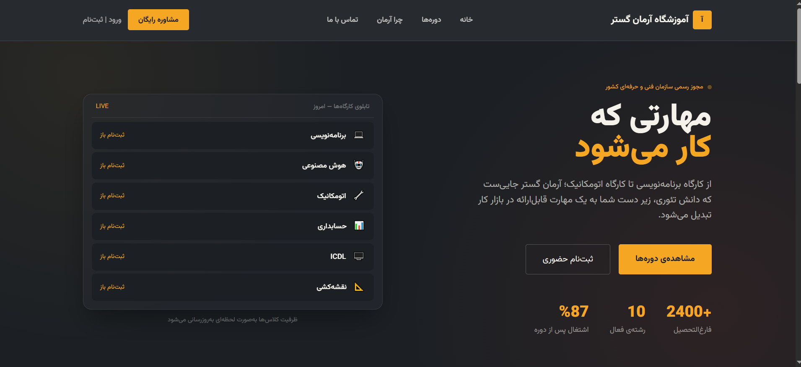
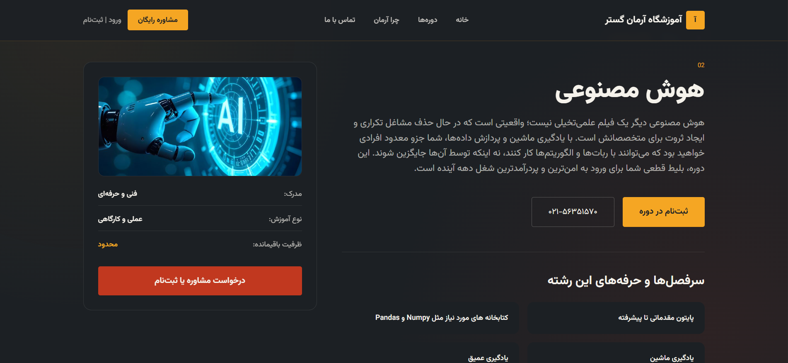
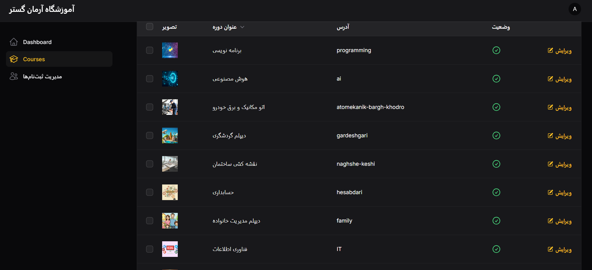
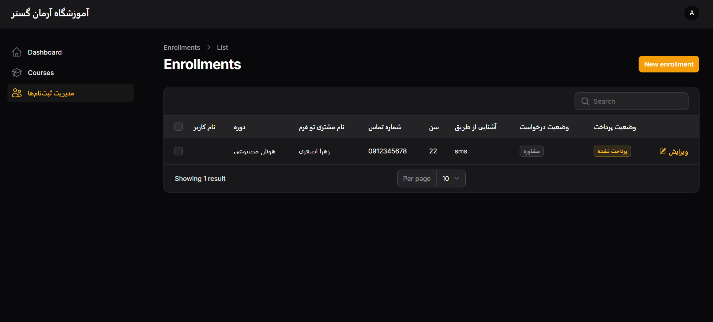
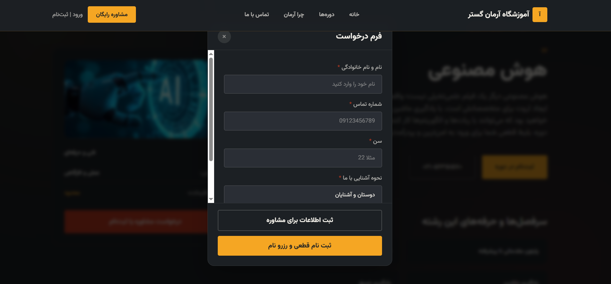

# Arman Gostar — Technical and Vocational Institute Website

A Laravel-based website developed for **Arman Gostar Technical and Vocational Institute** to introduce educational courses and manage course information and consultation requests.

🌐 **Live Website:** [armangostarr.ir](https://armangostarr.ir)

## Features

- **Course Management:** Admins can add, edit, and delete courses through the admin panel.
- **Course Details:** Each course can include a title, description, image, and curriculum.
- **Consultation Form:** Visitors can submit their information through the consultation form.
- **Consultation Request Management:** Submitted consultation information is available in the admin panel.
- **Admin Panel:** Provides administrative tools for managing courses and viewing consultation requests.
- **Responsive Design:** Designed to support different screen sizes.

## Screenshots

### Homepage



### Course Details



### Admin Panel — Course Management



### Admin Panel — Consultation Requests



### Consultation Form



### Responsive Design


## Technologies Used

- **Backend:** PHP, Laravel
- **Database:** MySQL
- **Frontend:** HTML, CSS, Tailwind CSS

## Installation

### Prerequisites

Make sure you have PHP, Composer, MySQL, and Node.js with npm installed.

### Setup

1. Clone the repository:

   ```bash
   git clone https://github.com/shsetayeshh/ArmanGostar.git
   ```

2. Navigate to the project directory:

   ```bash
   cd ArmanGostar
   ```

3. Install PHP dependencies:

   ```bash
   composer install
   ```

4. Create your environment configuration file by copying `.env.example` to `.env`.

5. Generate the Laravel application key:

   ```bash
   php artisan key:generate
   ```

6. Configure your database connection in `.env`.

7. Run the database migrations:

   ```bash
   php artisan migrate
   ```

8. Install and build frontend assets:

   ```bash
   npm install
   npm run build
   ```

9. Start the local development server:

   ```bash
   php artisan serve
   ```

Open the local address provided in the terminal to access the application.

**Note:** Additional configuration may be required depending on the project setup, database seeders, and Laravel version.

## Project Purpose

The purpose of this project is to make course information accessible online and simplify the management of educational courses and consultation requests for a technical and vocational institute.

## Developer

**Setayesh Sheihi**

GitHub: [@shsetayeshh](https://github.com/shsetayeshh)
